<p align="center">
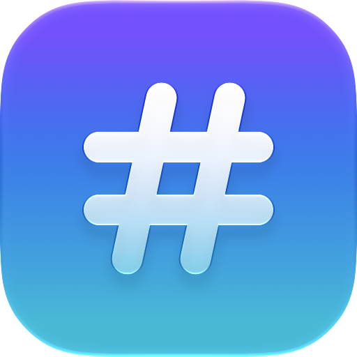
</p>

<h1 align="center">Lax</h1>

<p align="center">Lax is a <b>native</b> Slack client for macOS.</p>

<p align="center">
<a href="../../releases/latest">Download</a> ·
<a href="TODO.md">Roadmap</a> ·
<a href="docs/SLACK_PROTOCOL.md">How it talks to Slack</a>
</p>

---

## Features

* Written in Swift and SwiftUI for macOS 27, with standard Mac controls, menus and shortcuts
* Native lists, formatting and images, and no web view once signed in to ensure performance
* Sign in with your usual Slack login, SSO and 2FA included across several workspaces at once
* Channels, direct messages and followed threads, each in its own window or tab
* Threads open beside the conversation and search jumps straight to messages
* Rich text composer with ⌘B, ⌘I, ⇧⌘X and ⇧⌘C, and autocomplete for `@people`, `#channels` and `:emoji:`
* Custom and animated emoji everywhere, reactions, GIFs and videos
* Bot messages with Block Kit layouts and buttons, and slash commands
* Read state that follows what you've actually scrolled past, with unread messages marked
* A Slack-style badge on the Dock icon instead of notifications
* Open Quickly (⌘K), back and forward (⌘[ / ⌘]), and a keyboard shortcut for every message action

## Screenshots

| | | |
|:-:|:-:|:-:|
| 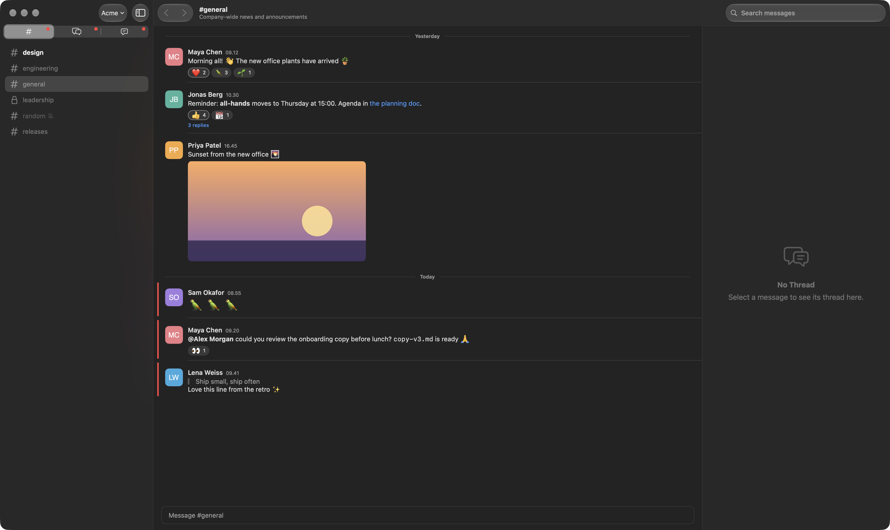<br>A channel | 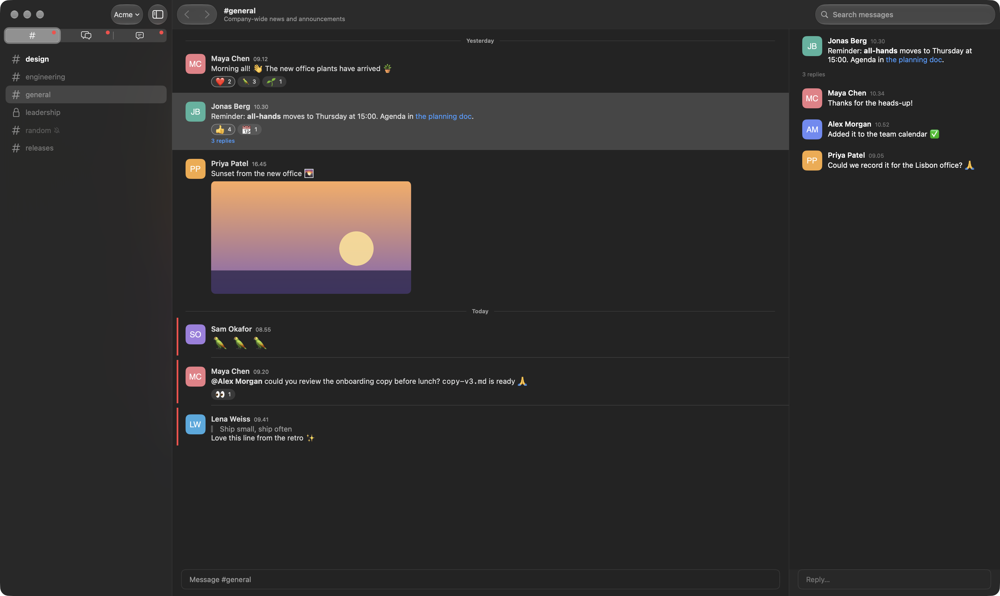<br>A thread beside it | 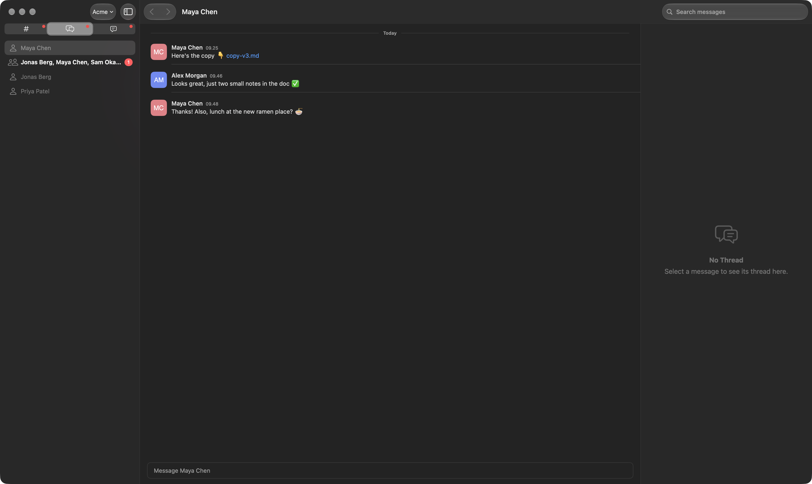<br>Direct messages |
| 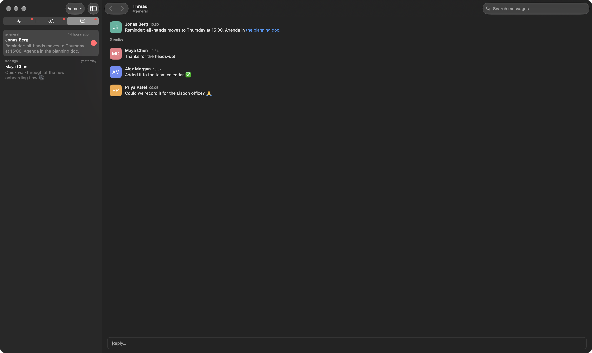<br>Followed threads | 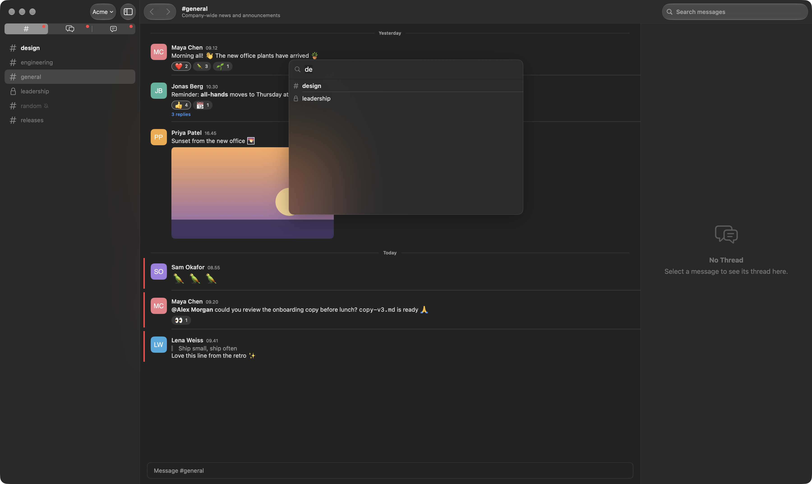<br>Open Quickly | 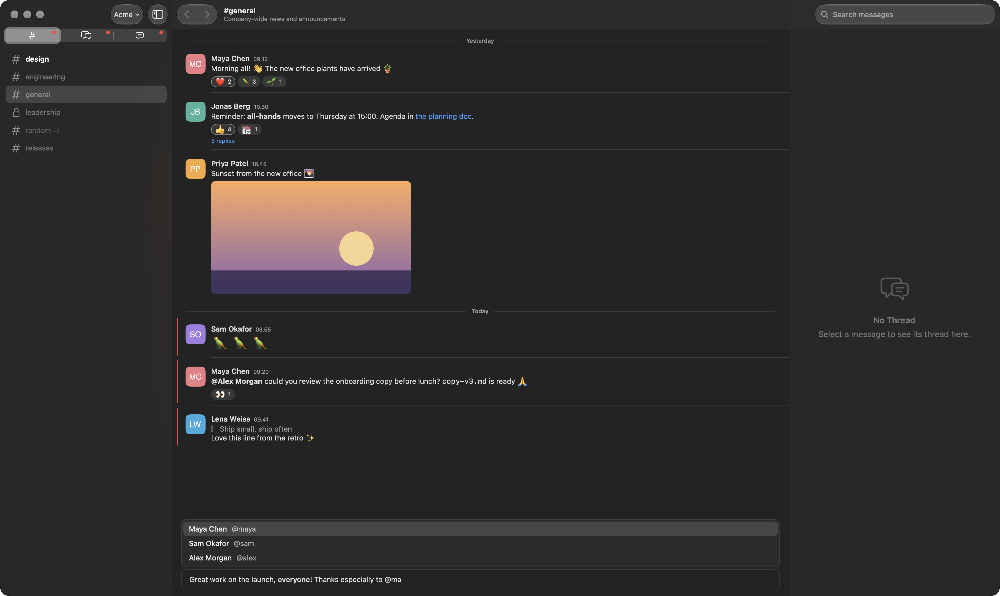<br>Composer and suggestions |
| 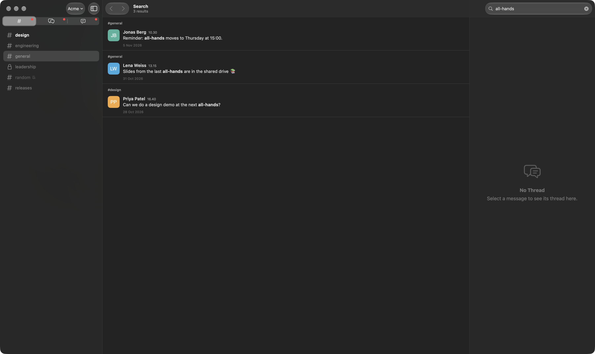<br>Search | 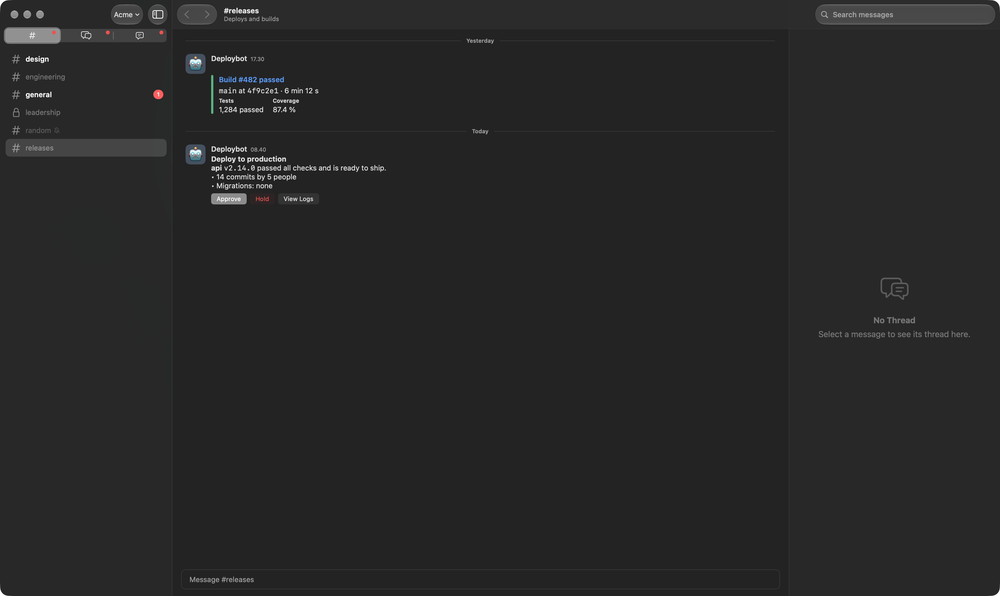<br>Bot messages and buttons | 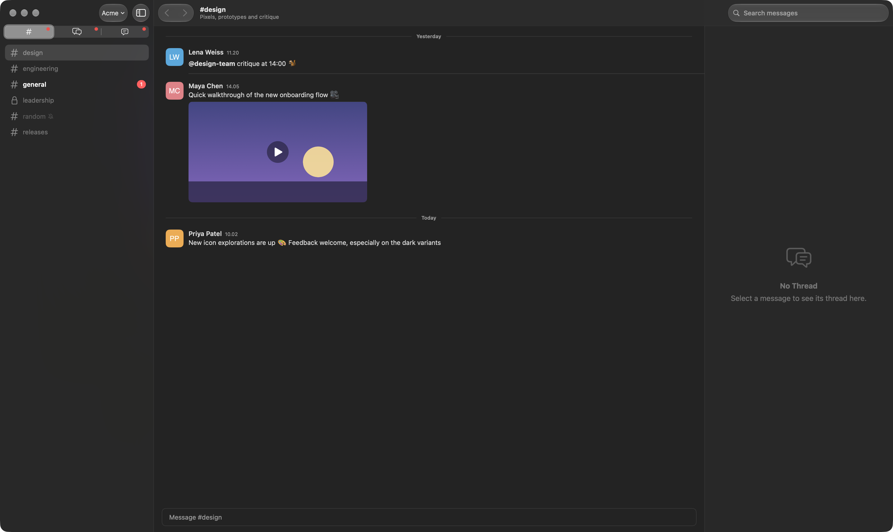<br>Video |
| 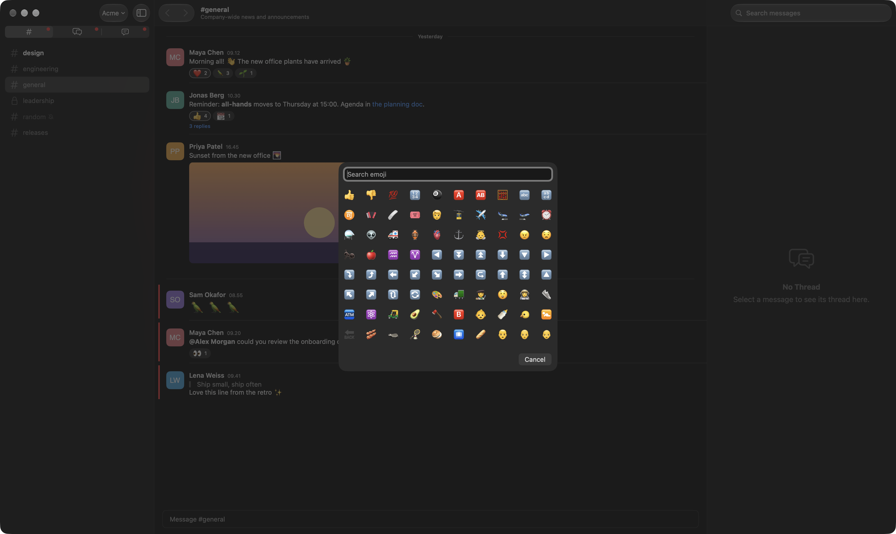<br>Emoji picker | 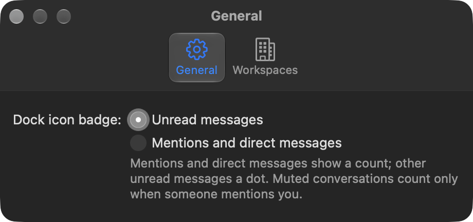<br>Settings | 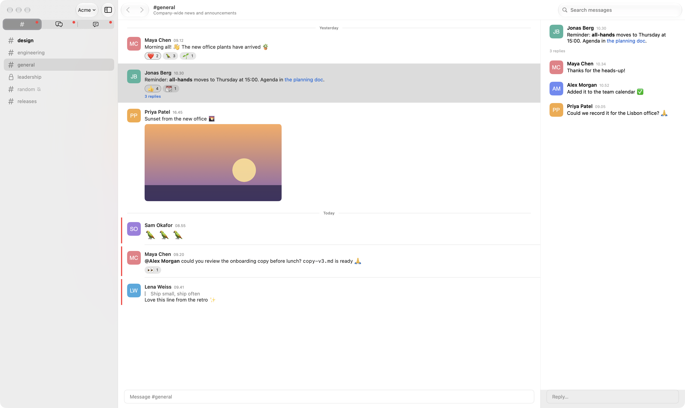<br>Light mode |

The people and conversations are a made-up workspace (`-demo`); `scripts/screenshots.sh`
retakes every screenshot.

## Download

Builds of `main` are published on the [Releases](../../releases) page.

They aren't notarized yet, so macOS stops the first launch. Open Lax once, then choose
**Open Anyway** in System Settings ▸ Privacy & Security. Alternatively, run
`xattr -dr com.apple.quarantine /Applications/Lax.app` after moving it there.

## Signing in and privacy

Lax signs in the way Slack's own web client does: you log in to `app.slack.com` in a
private web view, and Lax keeps the resulting session (an `xoxc-` token and the `d`
cookie) in your Keychain. It needs no Slack app, bot or admin approval, and talks only to
Slack. The session cookie is only ever sent to Slack's own hosts, over HTTPS. Message text
and tokens are never logged.

Lax uses the same interface as Slack's web client, which Slack doesn't document for
third parties, so check that it fits your workspace's policies.

## Keyboard shortcuts

| Action | Shortcut |
| ------ | -------- |
| Open Quickly | ⌘K |
| New tab, new window | ⌘T, ⌘N |
| Show or hide the sidebar | ⌃⌘S |
| Switch workspace | ⌃⌘1 to ⌃⌘9 |
| Add workspace | ⇧⌘N |
| Channels, Direct Messages, Threads | ⌘1, ⌘2, ⌘3 |
| Back, Forward | ⌘[, ⌘] |
| Previous or next conversation | ⌥⌘↑, ⌥⌘↓ (add ⇧ for unread ones) |
| Search messages | ⌥⌘F |
| Reply in thread | ⌘R |
| Add reaction | ⇧⌘\ |
| Mark message as unread | ⇧⌘U |
| Copy message, copy link | ⌘C, ⌥⌘C |
| Edit, delete own message | ⌥⌘E, ⌘⌫ |
| Mark conversation read or unread | ⇧⌘R |
| Mute or unmute conversation | ⇧⌘M |
| Bold, italic, strikethrough, code | ⌘B, ⌘I, ⇧⌘X, ⇧⌘C |
| New line in a message | ⇧↩ or ⌥↩ |

## Building

Lax needs Xcode 27 (the Command Line Tools alone lack SwiftUI's macros).

```sh
swift build          # debug build
swift test           # run the tests
swift run Lax        # run the app without bundling
scripts/bundle.sh    # release build, wrapped as build/Lax.app
scripts/screenshots.sh  # the README screenshots, from the demo workspace
```

`open build/Lax.app --args -demo` opens a made-up workspace that needs no Slack account, for
trying Lax out and for screenshots.

The code is in two parts:

- `Sources/LaxKit`: the Slack layer (sign-in, Web API, real-time connection, message
  formatting and state). Pure Swift, no UI, covered by Swift Testing.
- `Sources/Lax`: the SwiftUI app.

Ad-hoc signed builds ask for Keychain access again after every rebuild. If a certificate
named "Lax Local Code Signing" is in your keychain, `scripts/bundle.sh` signs with it
instead, and the Keychain remembers your choice.

## Contributing

Issues and pull requests are welcome. Pull requests need to pass three checks, which you
can run locally:

```sh
swift format lint --strict --recursive Sources Tests Package.swift     # Lint
swift format format --in-place --recursive Sources Tests Package.swift # Format
swift build -Xswiftc -warnings-as-errors && swift test                 # Build and Test
```

## License

Lax is released under the [MIT License](LICENSE).

Lax is not affiliated with or endorsed by Slack Technologies. Slack is a trademark of
Slack Technologies, LLC.
